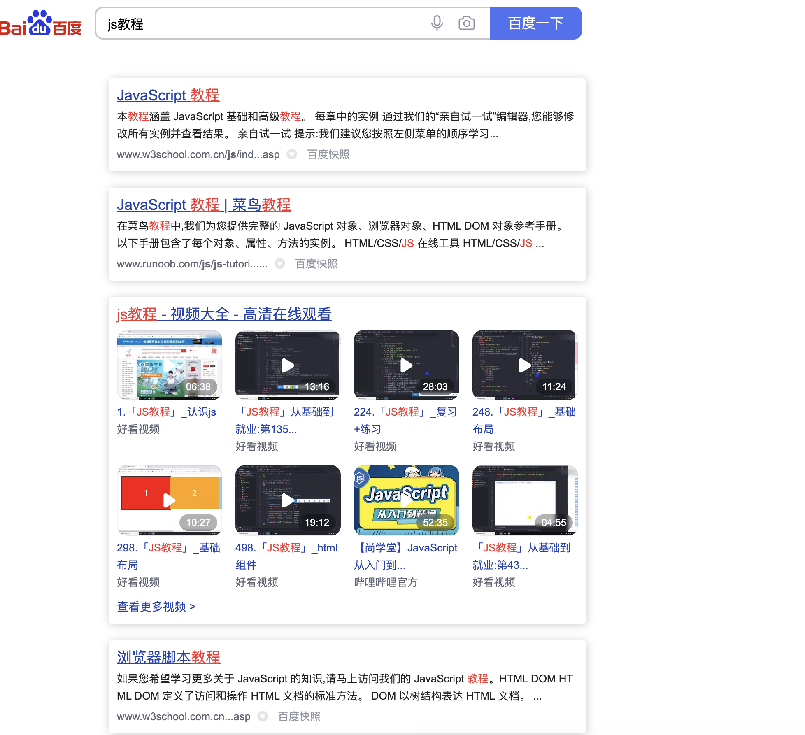
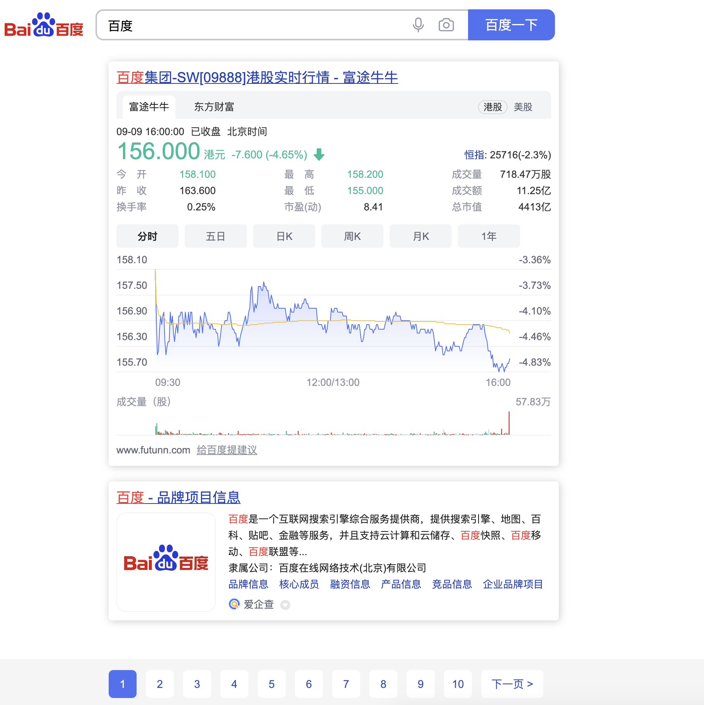
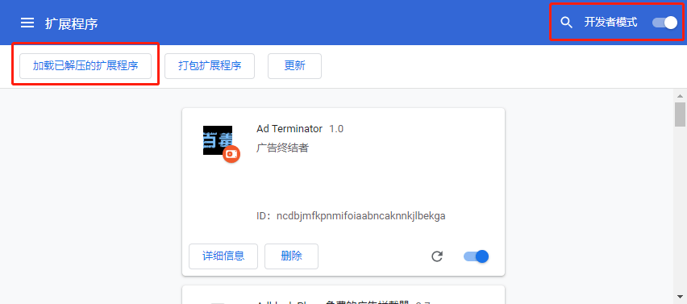
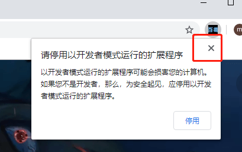
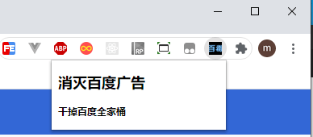

# Ad Terminator · 还搜索引擎一片清净

> 一款轻量的 Chrome 插件，屏蔽 **百度 / Bing / 搜狗 / 360 搜索** 结果里的 **百家号、CSDN、广告** 等低质内容。持续维护 5 年，完全免费。

[项目主页](https://github.com/xumengzi/Anti-Hundred-Poison) · [反馈误拦截](https://github.com/xumengzi/Anti-Hundred-Poison/issues/new) · [隐私说明](#隐私说明)

搜索一个技术关键词，首屏 10 条结果 —— 7 条广告、百家号、CSDN 复读。装上它，世界清净了。

## 效果一览

## 快速安装

- 🧩 **Chrome 用户**：见下方 [安装方法](#安装方法)（Chrome 商店版本上架中）
- 🐒 **油猴用户**：[戳这里安装 Greasy Fork 脚本版](https://greasyfork.org/zh-CN/scripts/455226-anti-hundred-poison-%E5%B1%8F%E8%94%BD%E7%99%BE%E5%BA%A6%E7%9B%B8%E5%85%B3%E7%9A%84%E8%84%9A%E6%9C%AC)

> 觉得世界清净了？麻烦点个 ⭐ **Star** 让更多被百度广告折磨的朋友看到 🙏

## 屏蔽范围

1. 搜索引擎首页与搜索无关的按钮 / 广告 / 热搜等元素，重点净化百度
2. 百度全家桶（百度知道、百度文库、百度百科等系列站点）
3. 搜索页顶部、右侧的推广位与设置项
4. 着重屏蔽 **CSDN**（如有冒犯，请勿使用）

> 仅推荐专业人士使用，不承担任何后果

## 安装方法

1. 下载(克隆), 把文件夹保存起来(这个就是解压后的谷歌插件)
2. 打开谷歌浏览器,进入插件设置界面`chrome://extensions/`
3. 打开「开发者模式」-「加载已解压的扩展程序」，右下角有一个刷新按钮，那是为了更新的，如果是更新那么点击刷新
4. 
5. 愉快的搜索吧

## 如何更新

1. 如果原先是克隆的，那么执行`git pull`，记得去浏览器插件管理去刷新一下，加载最新的资源，看不懂这个就执行步骤 2
2. 其他：再下载一次也行，执行一遍**安装方法**即可

## 屏蔽原理

1. 如果是用百度搜索，且条件有关于百度全家桶相关的字眼，那么这条搜索结果将会被删除;
2. 会隐藏搜索界面右侧，顶部，无关搜索的结果

## 欢迎诸位同仁志士提供意见

## Q&A

Q: 会对百度等搜索结果产生影响吗?

A: 不会，没那个能耐，仅仅是用`js`和`css`进行页面层面上的删除和隐藏

Q: 加载未知谷歌插件会被挖矿吗?

A: 我也想 0.0

Q: 安装未知插件，谷歌提示了咋办?

A: 当然是选择点叉叉忽略呗，还能咋样，原谅!

Q：为何只屏蔽百度相关的插件？？？？？？？？？？？？？?

A：讨厌这些

## 隐私说明

Ad Terminator 在本地读取搜索页面内容以匹配净化规则，不收集或上传搜索词、浏览记录及页面正文。站点开关和后续的自定义规则保存在 `chrome.storage.sync` 中，可能通过用户登录的 Chrome 账号跨设备同步；本页拦截计数仅在扩展内部临时处理。项目主页与反馈链接仅在用户主动点击后访问 GitHub。

权限用途：`storage` 用于保存设置，`activeTab` 用于 Popup 查询和操作当前页面，`webNavigation` 用于页面导航时清理旧计数。

## 不定期更新&维护

### 2026-08-25 更新

1. 产品名统一为 **Ad Terminator**
2. Popup 增加当前站点、运行状态和详细拦截统计
3. 增加临时显示已拦截搜索结果功能
4. 站点开关支持跨标签页同步
5. 增加项目主页、误拦截反馈和隐私说明入口

### 2026-08-24 更新

1. 增加是否屏蔽开关
   

### 2025-08-15 更新

1. 屏蔽新版搜索，启用旧版搜索
   

### 2025-01-06 更新

1. 屏蔽百度首页【AI 搜】入口

### 2024-09-23 更新

1. 搜索结果【相关搜索】四个字

### 2024-08-21 更新

1. 完善屏蔽百度 AI 回答结果

### 2024-08-08 更新

1. 增加屏蔽搜索页第一条【AI 智能回答】，对，这个也是百度的

### 2024-07-19 更新

1. 修改 readme 文案

### 2024-06-07 更新

1. 增加屏蔽百度首页【高考加油】入口

### 2024-03-11 更新

1. 增加屏蔽百度首页输入框滚动热搜词功能

### 2023-11-22 更新

1. 额外增加了对**Bing**，**搜狗**，**360**等搜索引擎进行相关屏蔽，欢迎体验并反馈

### 2023-11-07 更新

1. 增加「百度新闻」，「百度乐玩」，「百度统计」等十数个屏蔽关键字

### 2023-07-25 更新

1. 增加「百度健康」屏蔽关键字

### 2023-04-13 更新

1. 增加「百家号」屏蔽关键字
2. 屏蔽百度搜索栏输入框下边的 searchTag

### 2023-01-17 更新

1. 增加「百度短网址」，「百度营销」屏蔽关键字

### 2022-07-14 更新

1. 隐藏相关搜索（主体内容都搜不到，还指望相关搜索）
2. 大幅度提交脚本性能，再也不会像之前那么卡顿，欢迎升级
3. 谷歌插件升级到了版本`3`，如果你不知道这是啥，那么也不需要注意

### 2021-09-09 更新

1. 增加「度小满钱包」等更多屏蔽关键字

### 2021-07-30 更新

1. 增加「度小满」等更多屏蔽关键字

### 2021-04-03 更新

1. 屏蔽百度投放广告

### 2020-11-02 更新

1. 修复卡顿问题

### 2020-07-22 更新

1. 增加「百度百聘」，「百度号码认证平台」，「百度商桥」，「有钱花」等十余种关键字，屏蔽的内容更加丰富
2. 内容风格优化

### 2020-07-16 更新

> chrome 83 版本不会提示插件不在市场里了，还可以固定插件了

## 附录

### 对于百度的搜索结果，包含但不限于以下关键字那么这条搜索结果会被屏蔽

广告，CSDN，baidu，百度文库，百度知道，百度贴吧，百度手机助手，百度下载，百度卫士，百度百科，百度云，百度视频，百度推广，百度 AI，百度 App 技术，百度移动应用，百度杀毒，百度浏览器，百度输入法，hao123，百度影音，百度软件管理，百度经验，百度壁纸，百度下载助手，百度阅读器，百度电脑专家，百度一键 root，百度手柄，百度汉语，百度宝宝知道，百度糯米，百度图片，百度阅读，百度翻译，百度魔拍，百度刷机，百度企业信用，百度游戏，百度外卖，百度团购，百度日历，百度乐播，百度相机，百度贴吧青春版，百度地图，百度理财，百度游戏大全，百度多酷棋牌，百度天眼，百度财富，百度医生，百度网盘，百度德州扑克，百度路淘，百度聚聚，百度滴答，百度钱包，百度体育新闻，百度搜索资源平台，百度搜索风云榜，百度智能云，百度指数，百度学术，百度营销中心，百度爱采购，百度公益，百度识图，百度百聘，百度号码认证平台，百度商桥，有钱花，爱番番，FEX，度小满金融，度小满钱包，百度短网址，百度营销，百家号，百度健康，百度新闻，百度乐玩，百度统计
